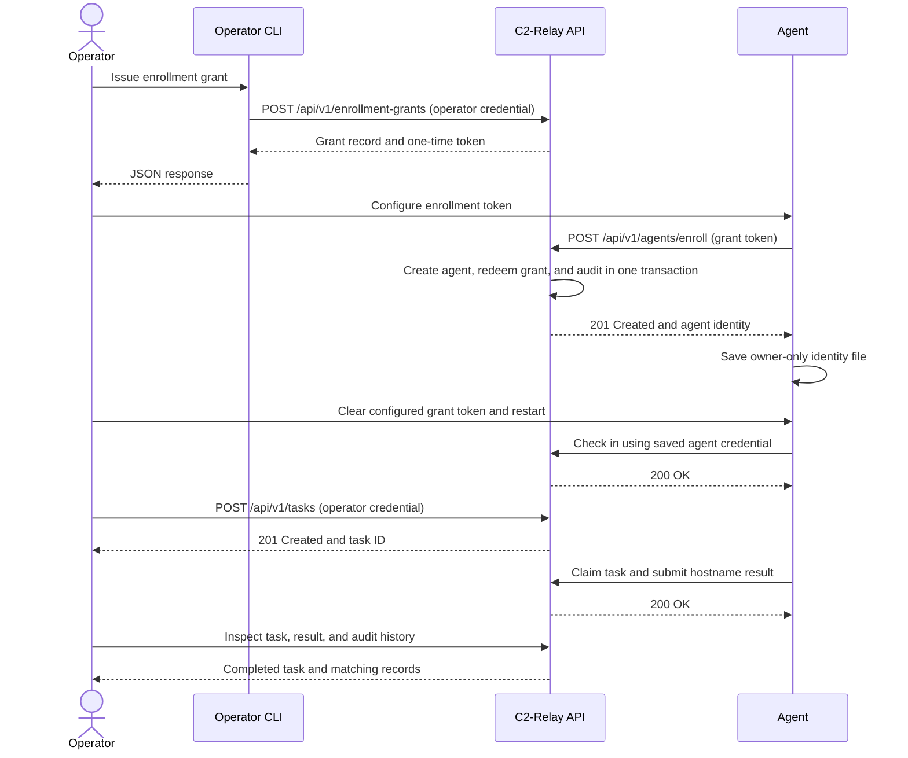

# C2-Relay v0.3.0 Verification Walkthrough

This writeup documents the verification of C2-Relay's v0.3.0 enrollment-security changes in an authorized local environment. It focuses on single-use enrollment grants, the operator CLI, and separate operator and agent authorization in Swagger UI.

The normal workflow builds on the [v0.2.0 walkthrough](release-verification-v0.2.0.md). Instead of repeating every reliability PoC from that release, I verified a fresh enrollment and task workflow before moving to the controls introduced in v0.3.0.

> [!IMPORTANT]
> C2-Relay is under active development and is not ready for operational use. Use it only on systems you own or are explicitly authorized to test.

## Automated Verification

Before beginning the manual walkthrough, I synchronized the environment and ran the automated verification suite:

```bash
uv sync --locked --dev
uv run ruff check .
uv run ruff format --check .
uv run mypy
uv run pytest
uv run alembic heads
```

Dependency synchronization, Ruff linting and formatting, mypy, and pytest all completed successfully. Alembic reported `20261002_0010` as the migration head.

> File counts, dependency counts, and execution times may vary with later repository changes. The required result is a zero exit status with no reported violations.

The manual verification was completed before the release metadata was updated from `0.2.1` to `0.3.0`. The `agent_version` values shown in the PoC payloads preserve the values used during those tests.

## Local Environment Preparation

I used a separate verification configuration so the new database, agent identity, and pending-result file would not interfere with the runtime state from previous versions. The existing root `.env` and runtime files remained unchanged.

The paths in this writeup are normalized to `.local/v0.3-verification.env`, with runtime files under `.local/v0.3-runtime/`. The verification artifacts were kept outside version control, and the verification env file was set to mode `0600` before adding any token. Exclude `.local/` in `.gitignore` before storing runtime artifacts there.

To reproduce the layout from a fresh clone, create the private configuration from the tracked example before applying the verification values below:

```bash
mkdir -p .local/v0.3-runtime
cp -n .env.example .local/v0.3-verification.env
chmod 600 .local/v0.3-verification.env
```

The file followed the settings in `.env.example`, with these values defining the isolated runtime and enrollment behavior:

```dotenv
C2_RELAY_DATABASE_URL=sqlite+pysqlite:///./.local/v0.3-runtime/c2-relay.db
C2_RELAY_AGENT_STATE_PATH=./.local/v0.3-runtime/agent-state.json
C2_RELAY_AGENT_RESULT_PATH=./.local/v0.3-runtime/pending-result.json
C2_RELAY_ALLOW_LEGACY_BOOTSTRAP_ENROLLMENT=false
C2_RELAY_BOOTSTRAP_TOKEN=
C2_RELAY_OPERATOR_CREDENTIAL=
C2_RELAY_AGENT_ENROLLMENT_TOKEN=
```

I left the operator credential blank so the CLI would request it through hidden input. The agent enrollment token was initially blank and was populated only when the new agent was ready to enroll.

Before creating the database, I checked the resolved paths:

```bash
uv run --env-file .local/v0.3-verification.env python -c \
'from c2_relay.core.config import Settings; s = Settings(); print(s.database_url); print(s.agent_state_path); print(s.agent_result_path)'
```

The output matched the expected verification paths:

```text
sqlite+pysqlite:///./.local/v0.3-runtime/c2-relay.db
.local/v0.3-runtime/agent-state.json
.local/v0.3-runtime/pending-result.json
```

> I used the same `--env-file` option for migration, operator, server, and agent commands throughout this session. Existing exported environment settings can affect the resolved configuration, so checking the paths first helped confirm that the commands targeted the intended runtime.

I then created the directory, initialized the database, and checked its applied revision:

```bash
mkdir -p .local/v0.3-runtime
uv run --env-file .local/v0.3-verification.env alembic upgrade head
uv run --env-file .local/v0.3-verification.env alembic current
```

The database reached the expected revision, `20261002_0010 (head)`. The new migrations introduced enrollment-grant storage and extended audit history for grant operations.

## Operator Provisioning

I provisioned a separate operator for the verification session:

```bash
uv run --env-file .local/v0.3-verification.env c2-relay-operator create --name "v0.3 Verification Operator"
```

The command returned an operator UUID and a one-time `c2o.` credential. I retained the credential privately and kept its value out of this writeup.

The operator UUID identifies the operator record. It is different from the agent UUID created during enrollment and the task UUID returned during task creation.

## Runtime Startup

### Terminal Layout

| Terminal | Purpose |
| --- | --- |
| `server` | Runs the API with the verification configuration and displays server logs |
| `agent` | Runs or pauses the agent using the isolated identity file |
| `input` | Runs operator CLI commands, curl requests, and local file checks |
| Browser | Uses Swagger UI at `http://127.0.0.1:8000/docs` |

Runtime commands use the project root as their working directory and pass the verification env file explicitly.

### Server Startup and Health Check

In the `server` pane, I started the API:

```bash
uv run --env-file .local/v0.3-verification.env c2-relay-server
```

In the `input` pane, I checked the health endpoint:

```bash
curl -i http://127.0.0.1:8000/api/v1/health
```

The response returned `200 OK` with `{"status":"ok"}`. This confirmed basic API availability; the following authenticated requests verified the operator and agent workflows.

## Normal Enrollment and Task Workflow



### Enrollment Grant Issuance

With the server running, I issued a grant through the operator CLI:

```bash
uv run --env-file .local/v0.3-verification.env c2-relay-operator grants issue
```

At the hidden prompt, I entered the verification operator's `c2o.` credential. The command returned JSON containing the non-secret `grant` record and a one-time `token` beginning with `c2g.`.

The response included the grant ID and its `expires_at` timestamp. The default grant lifetime was 900 seconds, or 15 minutes.

> [!NOTE]
> The enrollment window starts when the server issues the grant. The token must be redeemed before `expires_at`; this timestamp belongs to the grant and is separate from a task's claim lease.

The token authorizes enrollment of one agent. It does not replace an operator credential or the agent credential issued after enrollment. Although the grant record is non-secret, the complete issuance response contains the token and must be kept private.

### Agent Enrollment and Local Identity

I placed the returned token in `C2_RELAY_AGENT_ENROLLMENT_TOKEN` in the verification env file. In the `agent` pane, I then started the agent:

```bash
uv run --env-file .local/v0.3-verification.env c2-relay-agent
```

The new enrollment created `.local/v0.3-runtime/agent-state.json`. The running agent then continued its normal check-in and task-polling cycle.

I checked the file's permissions:

```bash
ls -l .local/v0.3-runtime/agent-state.json
stat -f '%Lp' .local/v0.3-runtime/agent-state.json
```

On the macOS verification host, `stat` returned `600`, confirming that only the owner could read and write the file. The file contained the agent UUID and credential, which I did not include in this writeup.

### Identity Reuse Without an Enrollment Token

After the identity file existed, I cleared the consumed grant token from the verification env file, leaving:

```dotenv
C2_RELAY_AGENT_ENROLLMENT_TOKEN=
```

I stopped the agent with `Ctrl-C` and restarted it with the same verification command. The server showed check-ins and task polling returning `200 OK`, with no new enrollment `201 Created` response.

This confirmed that the agent reused its saved identity rather than enrolling again. The grant was needed only for the initial exchange; subsequent runtime requests used the agent credential.

> The time-sensitive enrollment portion had ended once enrollment succeeded and the identity was saved. The grant's expiry no longer affected the enrolled agent's normal requests.

### Operator Authentication and Agent Inventory

In Swagger UI, I opened **Authorize** and placed the verification operator's `c2o.` credential in **OperatorBearer**. I initially left **AgentBearer** empty.

I called `GET /api/v1/agents` with its default parameters. The request returned `200 OK`, and the inventory showed the new agent with `status: active`. I kept that agent UUID for the following task request.

### Task Creation, Result Inspection, and Audit History

While Swagger remained operator-authenticated, I called `POST /api/v1/tasks` with the enrolled agent UUID and the allowlisted `host.hostname` action:

```json
{
  "agent_id": "<agent-id>",
  "action": {
    "kind": "host.hostname"
  }
}
```

I left the optional `Idempotency-Key` blank and submitted the request once. The endpoint returned `201 Created`; the response's `id` identified the new task, and `agent_id` matched the agent selected from the inventory.

The running agent claimed and completed the task. Using the task UUID, I called `GET /api/v1/tasks/{task_id}` and confirmed `200 OK`, `status: completed`, and the matching task and agent IDs.

I then called `GET /api/v1/tasks/{task_id}/result`. The response returned `200 OK` with the successful `host.hostname` result and the reported hostname.

Finally, I called `GET /api/v1/audit-events` with only the `task_id` filter populated. The response contained the three expected lifecycle events in newest-first order: `task.completed`, `task.claimed`, and `task.created`.

This verified that the new enrollment flow still connected to the existing task execution, result inspection, and audit workflows.

### Separate Swagger Authorizations

To verify the Swagger workflow improvement, I returned to **Authorize** and placed the saved identity file's `credential` value in **AgentBearer**, while retaining the operator's `c2o.` credential in **OperatorBearer**.

I entered only the credential values, without JSON quotes or a `Bearer ` prefix. Both authorization fields remained active at the same time.

`GET /api/v1/agents` returned `200 OK` using the operator scheme. I then called `GET /api/v1/agents/{agent_id}/tasks/next` with the agent UUID; it returned `200 OK` with `{"task":null}` because no queued task remained.

> [!NOTE]
> Both schemes use the standard `Authorization: Bearer` header. Swagger chooses the scheme declared by each route, while the API still validates the credential and its identity. Successful requests here verified the normal workflow; intentional credential misuse is a separate PoC below.

This removed the need to overwrite one shared authorization field when moving between operator and agent requests. Swagger's generated curl examples still contain plaintext credentials, so I kept them out of the writeup.

The normal verification walkthrough was complete at this point. The following section starts the focused PoCs.

## Focused Enrollment-Security PoCs

After completing the normal verification, I kept the server running and stopped the agent with Ctrl-C. The saved agent identity remained unchanged. The following PoCs focused on enrollment-grant lifecycle controls, credential separation, and audit history introduced in v0.3.0.

### Idempotent Enrollment-Grant Revocation

With the agent stopped, I generated another enrollment grant using the `c2-relay-operator grants issue` command. It returned a new `grant.id` and token. Using that grant ID, I ran `uv run --env-file .local/v0.3-verification.env c2-relay-operator grants revoke <grant_id>` twice and entered my operator credential at each prompt. The server logs showed the issuance and revocation requests:

```text
INFO:     127.0.0.1:<source_port> - "POST /api/v1/enrollment-grants HTTP/1.1" 201 Created
INFO:     127.0.0.1:<source_port> - "POST /api/v1/enrollment-grants/<grant_id>/revoke HTTP/1.1" 200 OK
```

Both revocation commands returned the same JSON, with an unchanged `revoked_at` timestamp, `revoked_by_operator_id` matching my operator ID, and `redeemed_at: null`.

I then used the returned `id` as the `enrollment_grant_id` filter on `GET /api/v1/audit-events`. The response contained one `enrollment_grant.issued` event and one `enrollment_grant.revoked` event. Repeating the revocation did not add another event.

### Revoked Grant Rejection

As the previous grant's 15-minute window had passed, I ran the `grants issue` command and received a new `grant.id` and token. I then ran the `grants revoke` command with that grant ID, using the same operator credential for both commands.

In Swagger, I opened `POST /api/v1/agents/enroll`, set `X-Enrollment-Token` to the new `c2g.` token, left `X-Bootstrap-Token` empty, and used this body:

```json
{
  "hostname": "revoked-grant-test",
  "operating_system": "test",
  "username": "verification",
  "agent_version": "0.2.1",
  "architecture": "test"
}
```

I submitted the request before the new grant expired and received `401 Unauthorized`, with the response detail indicating invalid credentials.

To check that the rejected request had not created another agent, I called `GET /api/v1/agents` and confirmed `total: 1`. I then called `GET /api/v1/audit-events`, filtering by the new grant's `enrollment_grant_id`. The response contained `total: 2`, with one `enrollment_grant.issued` event and one `enrollment_grant.revoked` event.

### Consumed Grant Reuse

I issued another grant. In Swagger, I opened `POST /api/v1/agents/enroll`, placed its `c2g.` token in `X-Enrollment-Token`, left `X-Bootstrap-Token` empty, and used this JSON body:

```json
{
  "hostname": "consumed-grant-test",
  "operating_system": "test",
  "username": "verification",
  "agent_version": "0.2.1",
  "architecture": "test"
}
```

I submitted the request once and received `201 Created`. I saved the returned `agent_id`, which identified the disposable agent created for this test, and immediately submitted the same request again with the same token and body. The second request returned `401 Unauthorized` with invalid credentials. Both requests were made before the grant expired.

On `GET /api/v1/agents`, I received `total: 2`: one record for my working agent and one for the disposable agent. On `GET /api/v1/audit-events`, filtering by `enrollment_grant_id` returned `total: 2`, with one `enrollment_grant.issued` event and one `enrollment_grant.redeemed` event.

I then cleaned up through `POST /api/v1/agents/{agent_id}/disable`, using the disposable agent's UUID. The request returned `200 OK`.

The unfiltered agent inventory still returned `total: 2`, while filtering by `status: active` returned `total: 1`, showing only my working agent.

### Expired Grant Rejection

I ran `uv run --env-file .local/v0.3-verification.env c2-relay-operator grants issue --expires-in 60`, which set `expires_at` to 60 seconds after issuance. I left the grant unused and unrevoked, then waited until it expired. I used `date -u +"%Y-%m-%dT%H:%M:%SZ"` to check the current UTC timestamp.

I kept the returned grant ID and token. In Swagger, I opened `POST /api/v1/agents/enroll` again, placed the expired grant's full `c2g.` token in `X-Enrollment-Token`, left `X-Bootstrap-Token` empty, and used this body:

```json
{
  "hostname": "expired-grant-test",
  "operating_system": "test",
  "username": "verification",
  "agent_version": "0.2.1",
  "architecture": "test"
}
```

The request returned `401 Unauthorized` with invalid credentials.

To double-check the result, I called `GET /api/v1/agents` without any filters and confirmed `total: 2`: my working agent and the disabled `consumed-grant-test` agent from the previous PoC. I then called `GET /api/v1/audit-events`, filtering by the expired grant's UUID in `enrollment_grant_id`. The response contained `total: 1`, with only an `enrollment_grant.issued` event.

### Missing or Incorrect Operator Credentials

I called `GET /api/v1/audit-events` with `event_type` set to `enrollment_grant.issued` and received `total: 5`. For reference, the same endpoint returned `total: 15` without any filters. I then logged out of `OperatorBearer` only, leaving `AgentBearer` unchanged.

On `POST /api/v1/enrollment-grants`, I used `{}` as the JSON body, submitted the request, and received `401 Unauthorized`. I then authorized `OperatorBearer` with a copy of my `c2o.` credential containing one changed character and repeated the same POST request. It returned `401 Unauthorized` again.

I restored the correct operator credential and confirmed that `GET /api/v1/agents` returned `200 OK`. I then repeated the audit query with the `enrollment_grant.issued` filter and received `total: 5` again. Without any filters, the total remained `15`, confirming that the failed requests had created no grants or additional audit events.

### Operator and Agent Credential Separation

I took the active agent's credential from `.local/v0.3-runtime/agent-state.json` and placed it in `OperatorBearer`. I then called `POST /api/v1/enrollment-grants` with `{}` as the JSON body and received `401 Unauthorized`.

I restored the correct operator credential in `OperatorBearer`, but placed that same operator credential in `AgentBearer`. On `GET /api/v1/agents/{agent_id}/tasks/next`, I supplied the active agent's `agent_id` from the identity file for convenience. The request also returned `401 Unauthorized`.

With both authorization fields restored to their correct values, I called `GET /api/v1/agents` again and received `200 OK`. I then called `GET /api/v1/agents/{agent_id}/tasks/next` with the same active agent UUID and received `200 OK` with `{"task":null}`.

### Legacy Bootstrap Enrollment Disabled

On `POST /api/v1/agents/enroll`, I cleared `X-Enrollment-Token`, set `X-Bootstrap-Token` to the placeholder value `verification-bootstrap-placeholder`, and used this JSON body:

```json
{
  "hostname": "legacy-bootstrap-test",
  "operating_system": "test",
  "username": "verification",
  "agent_version": "0.2.1",
  "architecture": "test"
}
```

The request returned `503 Service Unavailable` with `{"detail":"bootstrap operations are disabled"}`. I confirmed that the unfiltered agent inventory still contained `total: 2`, with no `legacy-bootstrap-test` agent.

### Grant Audit Attribution and Secret Handling

This one was more of an audit verification check. On `GET /api/v1/audit-events`, filtering `event_type` by `enrollment_grant.issued` returned five events. All contained my operator's UUID in `operator_id`, with `agent_id` and `task_id` set to `null`. Filtering by `enrollment_grant.revoked` returned two events with the same attribution pattern.

Filtering by `enrollment_grant.redeemed` also returned two events, but both `operator_id` and `task_id` were `null`, while `agent_id` identified the agent enrolled by that grant.

Each event had its own unique `id`, identifying the audit event itself, while `enrollment_grant_id` identified the relevant grant. The responses contained no tokens, credentials, digests, host metadata, or result output.

## Verification Summary

| Check | Expected result | Observed result |
| --- | --- | --- |
| Normal grant enrollment | CLI-issued grant enrolls a fresh agent | Completed; isolated identity file created |
| Local identity protection | Identity file permits owner access only | macOS `stat` returned `600` |
| Identity reuse | Restart succeeds without an enrollment token | Check-ins and polling returned `200`; no new enrollment `201` |
| Normal task and audit workflow | Hostname task completes and its result and lifecycle remain inspectable | Completed task, successful result, and three expected audit events |
| Separate Swagger authorization | Both credentials remain authorized and the appropriate route succeeds | Inventory returned `200`; agent polling returned `200` with `task: null` |
| Idempotent grant revocation | Repeated revocation preserves the existing state without duplicate events | Both commands returned the same JSON and timestamp; audit history retained one issuance and one revocation event |
| Revoked grant rejection | A revoked grant cannot enroll an agent before its expiry | `401 Unauthorized`; inventory remained unchanged and no redemption event was created |
| Consumed grant reuse | A grant permits only one successful enrollment within its lifetime | First request returned `201`, identical retry returned `401`; one redemption event remained and the disposable agent was disabled |
| Expired grant rejection | An expired, unused grant cannot enroll an agent | `401 Unauthorized`; inventory remained unchanged and grant history contained only the issuance event |
| Operator authentication | Missing or incorrect operator credentials cannot issue grants | Both attempts returned `401`; grant-issuance and audit totals stayed unchanged; correct credentials restored `200` access |
| Credential separation | Cross-role credentials are rejected on the tested operator and agent routes | Both misuse attempts returned `401`; restoring the correct credentials returned `200` for inventory and agent polling |
| Disabled legacy enrollment | Bootstrap enrollment is unavailable with legacy enrollment disabled | `503 Service Unavailable` with `bootstrap operations are disabled`; no additional agent appeared |
| Grant audit history | Events identify the relevant grant and actor without exposing secret material | Expected operator/agent references and null fields; distinct event/grant IDs; no tokens, credentials, or digests |

## Related Documentation

- See the [v0.2.0 walkthrough](release-verification-v0.2.0.md) for the earlier reliability and API-hardening PoCs.
- See the [README](../README.md) for current capabilities, platform support, and operating constraints.
- See the [CHANGELOG](../CHANGELOG.md#030---2026-11-06) for the v0.3.0 changes and known limitations.
- See the [architecture notes](architecture.md) for transaction boundaries, enrollment behavior, and security limitations.
